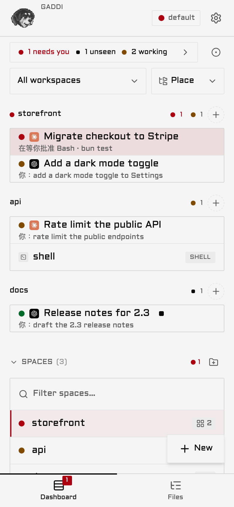
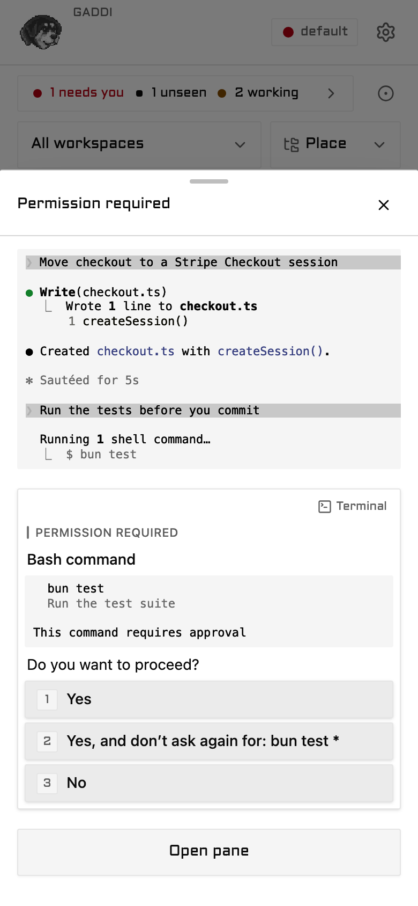
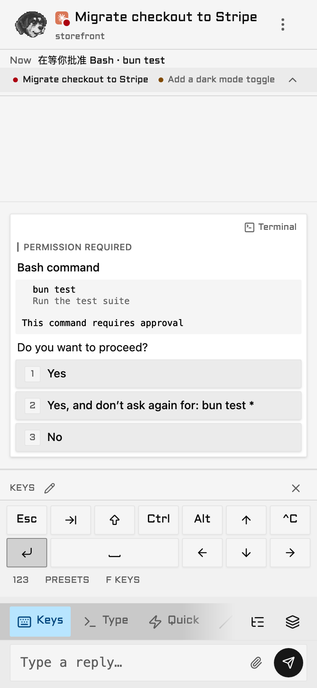

# Gaddi

<p align="center">
  
</p>

<p align="center"><b>English</b> · <a href="./README.zh-TW.md">繁體中文</a></p>

Gaddi puts the AI coding agents in your terminal on your phone. Claude Code, Codex and the rest keep
running in Herdr, tmux or zellij on your computer, and the phone shows which one is waiting on you.
You answer with a tap, not a terminal keyboard.

It runs on your own machine and reaches your phone over your Tailscale network. Gaddi has no account
of its own, no hosted backend and no telemetry; the connection is your Tailscale's. It isn't in an
app store: you open a URL on the phone and add it to the home screen.

> **Note.** Gaddi is [GGGODLIN's fork](https://github.com/GGGODLIN/gaddi) of
> [ColliePWA](https://github.com/AltanS/collie) by Altan Sarisin. It is not an official ColliePWA
> project. It installs from source and publishes its own releases. The `collie` command and the
> Herdr plugin keep their upstream names, so commands and the docs still say Collie.

https://github.com/user-attachments/assets/4c863f80-0167-4391-bdcd-4de76c67f654

<table>
  <tr>
    <td align="center" width="33%"><br><sub><b>What needs you comes first</b></sub></td>
    <td align="center" width="33%"><br><sub><b>Approve from the list</b></sub></td>
    <td align="center" width="33%"><br><sub><b>Keys a phone keyboard lacks</b></sub></td>
  </tr>
</table>

The video and the screenshots use made-up agents.

## What it does

- **The agent that needs you is at the top.** Every pane carries one line on what it's doing: the
  approval it waits for, or the last thing you asked it.
- **Approve without opening the pane.** Tap a blocked row and its permission prompt opens as
  buttons over the dashboard.
- **An agent's own questions become buttons**: permission prompts, AskUserQuestion, plan approval,
  menus.
- **The keys a phone keyboard doesn't have**: Esc, Ctrl+C, Tab, arrows, and your own sequences.
- **Start work from the phone**: a new agent, a command or a worktree, on any of your machines.
- **Durable agents** run beside the terminal multiplexer, with their own conversations, approvals
  and history ([experimental](./docs/durable-agents.md)).
- **Read back what happened**: search the output, read the whole session as Chat, and browse the
  workspace's files and diffs, read-only.
- **A push notification** when an agent stops and waits for you, once you turn Web Push on
  ([Voice input and Web Push](./docs/voice-and-push.md)).

### Your agents on the iPhone's Dynamic Island

The fork's main addition is an iPhone app, in [`ios/`](./ios/README.md), that puts your agents'
state on the Dynamic Island and the lock screen, and opens Gaddi when you tap it. Build it, or
sideload the `.ipa` each release carries; either way it is signed with your own Apple ID. The app
updates the island itself, from your Gaddi, with no push service in between.

<table>
  <tr>
    <td align="center" width="62%">
      <br>
      <sub><b>Island</b>: how many agents wait for you</sub><br><br>
      <br>
      <sub><b>Long press</b>: the pane that needs you, what it waits on, and the counts</sub>
    </td>
    <td align="center" width="38%">
      <br>
      <sub><b>Lock screen</b>: the same card</sub>
    </td>
  </tr>
</table>

The screenshots use made-up agents. The second line, what the pane is doing, shows only with
`ISLAND_SHOW_DETAIL = YES`, because it can be your newest prompt word for word; by default the
island shows the pane's name and the counts. The pane's name still shows on the lock screen, so
name panes with that in mind.

What the island asks of you, before you decide to install it
([`ios/README.md`](./ios/README.md) has each in full):

- **An iPhone on iOS 18 or newer**, and location set to **Always**: that is how the app stays awake
  in the background. Its battery use has not been measured.
- **A restart every 8 hours.** iOS ends a Live Activity after 8 hours, and an iOS update may end it
  sooner.
- **Re-signing every 7 days** with a free Apple ID. AltStore does it in the background while
  AltServer is reachable; a week without it and the app stops opening until you refresh it.
- **A Mac or a Windows PC to sign it.** AltServer has no Linux version, so a Linux host still needs
  one of them nearby.

The home-screen web app and the iPhone app are two different things:

| | Home-screen web app | iPhone app |
| --- | --- | --- |
| Approve, reply, read panes | Yes | Yes, through the same web app inside it |
| Dynamic Island and lock screen | No | Yes |
| Push notifications | Yes, once Web Push is on | No; keep the web app for them |
| Pairing | Its own pairing | Its own pairing, separate from the web app's |
| Updates | With Gaddi's own update | Install the new `.ipa` over the old app when a release says so |

## Before you install

You need:

- **A Mac or a Linux machine** that stays awake and online while you are away from it: Gaddi and
  your agents run there, and the phone only reads them. Windows is experimental, see
  [Windows](#windows).
- **[Bun](https://bun.sh) 1.3.14 or newer and git.**
- **One multiplexer, with your agents running inside it.** [Herdr](https://herdr.dev) is the setup
  the maintainer runs every day. tmux and zellij work too but are experimental
  ([Multiplexers](./docs/multiplexers.md)). An agent started in a plain terminal tab does not show
  up; start it in a pane of the multiplexer.
- **[Tailscale](https://tailscale.com) on the computer and the phone, on the same tailnet, with
  HTTPS turned on** (admin console → DNS → Enable HTTPS). On a Mac, the `tailscale` command must be
  on your PATH; the Tailscale app can install it from its settings.

The maintainer runs it on a Mac with Herdr, Claude Code and an iPhone, and that is the route this
README walks. The other combinations pass CI but have not been walked end to end for this fork.

Gaddi is for one person: one operator, one tailnet, no shared or public access.

**Gaddi provides remote shell access to your machine by design.** A single API call sends
arbitrary keystrokes directly into a live terminal pane. A paired device can read pane output
(source code, secrets, environment variables, agent output) and run any command as your user.
There is no sandbox and no command allow-list, as these would defeat the core workflow.

Every request needs a device you paired with `collie pair`; knowing the URL is not enough. Pairing
is always on. Treat a paired phone like an SSH key to your account: keep Gaddi on your tailnet, set
`COLLIE_TRUSTED_USER` so only your tailnet login gets through
([Variant A](#variant-a--tailscale-serve--person-identity-default)), and pair only the phone you
use. [`docs/security.md`](./docs/security.md) has the security model in full.

> 🚫 **Never `tailscale funnel` this**: `funnel` exposes the port to the public internet, whereas
> `serve` limits access to your private tailnet. Do not funnel Gaddi under any circumstances.

## Install

Gaddi installs from source. Start your agents in the multiplexer first: `start` mirrors the one it
finds running, and refuses when there is none. With tmux, that is:

```bash
tmux new -s agents      # then run claude (or codex) inside it
```

Then, in another terminal:

```bash
git clone --single-branch https://github.com/GGGODLIN/gaddi.git ~/.local/share/collie &&
  cd ~/.local/share/collie && bash scripts/collie-ctl.sh build && bin/collie start
```

Each step runs only if the one before it succeeded. If `~/.local/share/collie` already exists (an
upstream install, say), the clone stops there and nothing is built over it; move it aside first.
`--single-branch` fetches `main` alone, and later updates keep to it. `start` runs
`tailscale serve` for you and prints the HTTPS address.

Then put it on the phone. The commands below run in `~/.local/share/collie`; `bin/collie link`
puts `collie` on your PATH if you want the short form.

1. Run `bin/collie url` and open the address it prints in Safari on the iPhone.
2. Tap **Share**, then **Add to Home Screen**, then open Gaddi from the new icon.
3. Run `bin/collie pair` and type its 8-character code in Gaddi under Settings → System → Paired
   devices.

Type the code inside the home-screen app rather than scanning the QR code: the QR code opens
Safari, and a pairing made in Safari may not carry over to the home-screen app. On Android, use
Chrome and the **Install** card in Gaddi's Settings. [`docs/install.md`](./docs/install.md#start-it) has the
rest of first run, from *Start it*.

`main` moves only when a release is cut or the docs change, so the code you install is always a
release's. Day-to-day work happens on `dev`, which is not tested for anyone else's use.

## Update and roll back

`collie update` and the in-app update banner follow [this fork's
releases](https://github.com/GGGODLIN/gaddi/releases). The update pulls `main`, rebuilds and
restarts:

```bash
cd ~/.local/share/collie && bin/collie update
```

To go back to an earlier release, check out its tag, rebuild and restart. Stay within 2.x: a
release before 1.18.0 lets anyone who reaches the URL read every pane, paired or not.

```bash
cd ~/.local/share/collie && git fetch --tags && git checkout v2.0.2 &&
  bash scripts/collie-ctl.sh build && bin/collie restart
```

The checkout is then detached at that release. To return to the latest, switch back to `main` and
update; checking out `main` alone changes the source, not the running Gaddi.

```bash
cd ~/.local/share/collie && git checkout main && bin/collie update
```

> **Note.** An install made before 1.14.0 cannot pull the new `main`. Move
> `~/.local/share/collie` aside and install again; settings, pairings and push subscriptions live
> under `~/.config` and `~/.local/state`, not there.

## Optional companions

Everything in this table is optional, and Gaddi runs the same without it. The first two rows read
the output of the maintainer's own Claude Code tools; the third is the iPhone app.

| Feature | Needs | Without it |
| --- | --- | --- |
| A pane's description can use Claude's own recap, and the mirror hides the tool's button row | [cc-mod-waitwhat](https://github.com/GGGODLIN/cc-mod-waitwhat) | The description uses the waiting approval or your newest prompt |
| *Plain* and *Lost* retell a Claude session in plain words | [cc-sidecar-waitwhat](https://github.com/GGGODLIN/cc-sidecar-waitwhat), named in `retell.toml` ([Configure](./docs/configure.md#retell-a-claude-session)) | The two rows are not offered |
| Agents' state on the iPhone's Dynamic Island | The iPhone app in [`ios/`](./ios/README.md), built or sideloaded with your own Apple ID; it reads Gaddi or upstream Collie | Nothing changes; Gaddi's Settings row for the app's address shows only inside the app |

A pane's description line follows the app's language. A recap shows as Claude wrote it, and a push
notification's text stays in Traditional Chinese.

## Documentation

The pages below come from upstream and say Collie. Their install commands (`colliepwa.dev`'s
script, `AltanS/collie`, the packages and the Herdr plugin) install upstream Collie, not Gaddi; for
Gaddi, use [Install](#install) above. Everything after installing applies to both.

### Guides

| | |
| --- | --- |
| [**Install in five minutes**](./docs/five-minute-install.md) | The recommended setup, step by step: Tailscale, Herdr and Collie on your computer, then a paired phone with Collie on its home screen |
| [**Claude Code in tmux or Herdr, on your phone**](./docs/claude-code-on-your-phone.md) | Keep Claude Code running in tmux or Herdr when SSH drops. Manage sessions, start new agents and worktrees, approve prompts, and send Esc or Ctrl from your phone with push alerts. |

### Sessions

| | |
| --- | --- |
| [**Sessions**](./docs/sessions.md) | What a session is, where sessions come from, a terminal or a durable agent, and what the phone shows for each |
| [**Terminals**](./docs/multiplexers.md) | Pointing Collie at Herdr, tmux, zellij, tuios or Tern, what each can answer, and agent beacons. Experimental for tmux, zellij, tuios and Tern; bug reports wanted |

### Durable agents

| | |
| --- | --- |
| [**Durable agents (experimental)**](./docs/durable-agents.md) | Show your own durable agent on your phone: the quickstart, `collie durable attach` and `sources.json`, the three verbs, tokens, the files Collie keeps, and the versions |
| [**Durable agents on the phone**](./docs/durable-agents-on-the-phone.md) | What a durable agent's section, conversations, questions and receipts look like |
| [**Troubleshooting a durable agent**](./docs/durable-agents-troubleshooting.md) | A durable agent that does not show up or says Unreachable: the first checks, every reason and what fixes it, the doctor rows, and the cases that come up |
| [**Security of a durable agent**](./docs/durable-agents-security.md) | What a durable agent can and cannot do, the trust rules of the socket and of the token, what Collie does to a durable agent's text, and what the audit log keeps |
| [**The durable SDK (experimental)**](./docs/durable-sdk.md) | The npm package `@colliepwa/durable-sdk`, part by part: its entries and runtimes, `openCollie`, the pane methods, the four kinds of question and `requireApproval`, hooks, history, caps, the helpers, the Pi glue and the versions |
| [**The durable wire (experimental)**](./docs/durable-wire.md) | What travels between Collie and a durable agent, for a builder: the routes, hello and the epoch, the life of an ask and the request ids, the socket and token transports, the limits and the version rule, with a link to `WIRE.md` for the exact rules |

### Reference

| | |
| --- | --- |
| [**Install**](./docs/install.md) | The front door you need, then the install for your system: Linux, Arch and Omarchy, Nix, macOS, Windows, or as a Herdr plugin. Covers first run, setup on an iPhone or Android phone, updates, and uninstallation |
| [**Windows**](./docs/windows.md) | Windows 11 with Herdr: what is supported, installing with `install.ps1`, the unsigned binary, updating, long paths, and what is not tested |
| [**Security**](./docs/security.md) | What a Collie exposes, the defenses, and pairing a device, the credential for every request |
| [**Configure**](./docs/configure.md) | The `.env`, your own slash commands, keys, quick replies, launchers and typefaces; appearance, Zen mode, language |
| [**Themes**](./docs/themes.md) | The four looks Collie ships, picking one in Settings, importing a theme file after a preview, exporting one to edit, and writing your own: the 43 colour tokens, the shape and look words, the terminal palette, and what a theme cannot change |
| [**Changes**](./docs/changes.md) | The Files screen: a workspace's folder with its changes marked, the changed files and their diffs, and the last commit, from the pane or the dashboard's Files tab. Read-only git, nested repos, and the two settings that decide how far it looks |
| [**Deployment**](./docs/deployment.md) | Front doors other than the default: an identity-aware proxy, a reverse proxy with no Tailscale, an off-host ingress, several Collies on one host (one per user, or several instances for one user), and a crew's standby door |
| [**Commands**](./docs/commands.md) | Every `collie` verb, putting `collie` on your PATH, and the Herdr actions that mirror the verbs on a Herdr-managed install |
| [**Crews**](./docs/crew.md) | Several machines' Collies behind one URL: invite, join, deputy, failover |
| [**Voice input and Web Push**](./docs/voice-and-push.md) | The microphone in the composer, and notifications when an agent is waiting on you |
| [**Manage & update**](./docs/upgrading.md) | Update from the phone or the terminal, roll back, update a crew, cross a major, stop, uninstall, and upgrading a 0.x install to 1.0 |
| [**Troubleshooting**](./docs/troubleshooting.md) | Symptoms in the words you would actually search for |
| [**Terminology**](./docs/terminology.md) | Collie's words in plain words, beside the names other tools use: session, space, tab, pane, terminal, durable agent, harness, crew, lead, and more |
| **For an AI coding agent in your terminal** | `collie skill` prints a brief on how Collie works, and `collie docs` prints the pages above, both out of the binary and with no network |

Repository-level specifications live at the root: [`ARCHITECTURE.md`](./ARCHITECTURE.md) ·
[`docs/deployment.md`](./docs/deployment.md) · [`MUX_CONTRACT.md`](./MUX_CONTRACT.md) ·
[`CREW_PROTOCOL.md`](./CREW_PROTOCOL.md) · [`HERDR_API.md`](./HERDR_API.md) ·
[`DESIGN.md`](./DESIGN.md) · [`CONTRIBUTING.md`](./CONTRIBUTING.md).

## Deployment variants

Collie always binds **loopback only**; what changes between deployments is *what sits in front
of it* and *how a request proves who it is*. Variant A is the default and sits below; the other four
are in [`docs/deployment.md`](./docs/deployment.md). Pick one.

### Variant A — `tailscale serve` + person identity (default)

The happy path from [Install](./docs/install.md#install). `tailscale serve` terminates TLS on your MagicDNS name and
injects `Tailscale-User-Login`; set `COLLIE_TRUSTED_USER` to your tailnet login and Collie
rejects anyone else.

```bash
# in your .env
COLLIE_TRUSTED_USER=you@example.com
```

- **Granularity:** the tailnet *person*, not the device.
- **Why it's safe on bare `tailscale serve`:** serve is the *trusted injector* of
  `Tailscale-User-Login` — it sets that header itself and a client can't forge it through the proxy.
- Nothing else to configure; origins match automatically on the MagicDNS name.
- Per-device control comes from [pairing](./docs/security.md#pair-a-device--the-write-credential),
  which is always on and applies on top of this variant.

This is the right choice unless you specifically need a proxy in the path. If you do, or if Tailscale
isn't in the path at all, [`docs/deployment.md`](./docs/deployment.md) has the rest:

- **[B — identity-aware proxy, authorised by device](./docs/deployment.md#variant-b--identity-aware-proxy--per-device-authorisation)** — a proxy on this host; some devices drive, others watch.
- **[C — reverse proxy as the only front door](./docs/deployment.md#variant-c--reverse-proxy-as-the-only-front-door-no-tailscale)** — no Tailscale anywhere in the path.
- **[D — off-host identity proxy over the tailnet](./docs/deployment.md#variant-d--off-host-identity-proxy-over-the-tailnet)** — one central ingress node fronting Collie among your other services.
- **[E — any other mesh or tunnel](./docs/deployment.md#variant-e--any-other-mesh-or-tunnel-netbird-zerotier-cloudflare-tunnel)** — NetBird, ZeroTier, Cloudflare Tunnel: you own the ingress, Collie publishes nothing.

## Windows

Linux and macOS: nothing changes for you.

**Today:** Fork releases build an experimental Windows zip when the Windows payload job succeeds.
Check the release assets before installing. Install only when the assets include
`collie-<version>-windows-x64.zip`. If they do not, `install.ps1` and `collie update` say so and
install nothing. This fork permanently waives only the Windows VM install, update and rollback
rehearsal, and that path remains unverified. Phone access needs a front door that you set up yourself,
and it has not been tested with this fork on Windows.

Upstream's installer:

```powershell
irm https://colliepwa.dev/install.ps1 | iex
```

Upstream v1.16.0 is its first release with a Windows zip. Its installer was run against that release on
a Windows 11 VM, and `collie start`, `status`, `doctor` and `stop` worked. Phone access over HTTP
through Tailscale Serve was run too. Not tested yet are an update between two real releases on
Windows and the HTTPS form of Tailscale Serve on Windows, which is why it stays experimental.

The release check requires the Windows zip from now on. Only the maintainer can override that, for a
Linux hotfix.

Windows 11 on x64 with Herdr is a supported host: the maintainer owns the code and tests it.
The conditions for dropping the word are on the Windows page. [**docs/windows.md**](./docs/windows.md)
has the install, the update, and what is not tested. In short:

- **Checks.** The `windows.yml` workflow runs the bridge, cli and scripts tests on pull requests
  and pushes to `main`. This fork permanently waives only the Windows 11 VM rehearsal; install,
  update and rollback remain unverified. ([ADR 0075](./.adr/0075-windows-is-a-supported-host.md))
- **Installed without a toolchain.** Each release builds `collie-<version>-windows-x64.zip`, and
  `scripts/install.ps1` installs it. The binary is unsigned, and Smart App Control can block it.
- **Run by Task Scheduler.** `collie start`, `stop`, `restart`, `status` and `uninstall` work as they
  do elsewhere. The task is named `herdr.collie` and starts at your logon.
- **Not covered.** tmux and zellij (neither has a Windows build), Windows 10, Windows on ARM,
  a Windows machine joining a crew, and a managed front door: Collie does not run `tailscale serve`
  on Windows, so bring your own,
  [Variant C](./docs/deployment.md#variant-c--reverse-proxy-as-the-only-front-door-no-tailscale).
  Herdr's action buttons need `bash`, so the manifest lists only `linux` and `macos`.

Herdr on Windows exposes its control socket as a named pipe derived from the full socket path instead
of an AF_UNIX socket. Collie connects through `node:net` rather than `Bun.connect`, with a single shim,
[`bridge/dial.ts`](./bridge/dial.ts), which documents the path mapping. The socket path defaults to
`%APPDATA%\herdr\herdr.sock`; override it with `HERDR_SOCKET_PATH`. Explicit `\\.\pipe\...` values pass
through directly. The bridge logs `[events] stream up` on startup when event streaming runs over the pipe.

`COLLIE_HERDR_DIAL=net` forces the `node:net` dialer on Linux and macOS. This allows testing the
Windows connection path without a Windows environment; `bridge/dial.test.ts` relies on it.

## Architecture

A small Bun process sits between your phone and your multiplexer — the browser never touches the
multiplexer.

```
  phone (PWA)
     │  HTTPS over the tailnet
     ▼
  tailscale serve        terminates TLS, injects the identity header
     │  127.0.0.1:PORT    (the bridge binds loopback only)
     ▼
  Collie bridge (Bun)    serves the UI + a small JSON API; polls the multiplexer
     │  one mux adapter, chosen per install
     ▼
  the multiplexer        owns the panes, agents and terminal state
  Herdr · tmux · zellij
```

Under [Variant C](./docs/deployment.md#variant-c--reverse-proxy-as-the-only-front-door-no-tailscale) a
reverse proxy replaces the `tailscale serve` box; everything below the front door is identical.

- **Only the adapter touches the multiplexer** (`bridge/mux/<name>/` — Herdr dials a Unix socket, tmux and zellij shell out to their CLIs); everything else speaks the bridge's HTTP API. What every adapter must answer is [`MUX_CONTRACT.md`](./MUX_CONTRACT.md).
- **Polling is still the model** — the bridge takes one snapshot per tick from the adapter and the browser polls `/api/snapshot`; where the multiplexer offers an event stream (Herdr does) it only pokes the bridge's poll to go faster, it never replaces it. No resync logic.
- **Actions are plain HTTP** — a reply or key `POST`s to `/api/pane/:id/{reply,keys}`, and the adapter types it into a real terminal (hence the security posture).
- **The UI is a static PWA** — Vite builds `web/dist`, served from disk, so a rebuild is live with no restart.
- **A second Collie is a peer, not a second bridge** — one machine's bridge mirrors one multiplexer, and a lead reads its peers over the crew link ([`CREW_PROTOCOL.md`](./CREW_PROTOCOL.md)).

Full design rationale in [`ARCHITECTURE.md`](./ARCHITECTURE.md).

## Developing

Clone and build the repository
([Install → the same result, from source](./docs/install.md#the-same-result-from-source)), then edit
in place.

- **Every verb is implemented once, in `cli/`,** and runs as `bin/collie <verb>`
  ([Commands](./docs/commands.md)). No other layer implements verbs. `scripts/collie-ctl.sh` is a
  bootstrap shim that compiles the binary and passes your argv. The Herdr adapter's
  `herdr-plugin.toml` is a thin registration file whose `[[actions]]` call that shim
  ([Herdr actions](./docs/commands.md#herdr-actions)). Both files contain explanatory comments.
- **Development loop asymmetry:** `web/` rebuilds appear immediately without a restart because the
  bridge serves `web/dist` directly from disk. Changes to `bridge/` require
  `systemctl --user restart collie`. Build, test, and versioning rules live in
  [`CLAUDE.md`](./CLAUDE.md). Versioning is enforced by git hooks, so check the document before
  committing.
- **Multiplexer adapters:** [`MUX_CONTRACT.md`](./MUX_CONTRACT.md) defines the interface an adapter
  must implement, and [`MUX_CONTRIBUTING.md`](./MUX_CONTRIBUTING.md) covers the integration
  boundaries. [`ARCHITECTURE.md`](./ARCHITECTURE.md) §3 explains why Collie runs as a supervised
  service instead of an embedded pane, which keeps the Herdr manifest limited to `[[actions]]` and
  `[[build]]`.
- **Pull requests:** send them to this fork's `dev` branch; `main` takes only releases and docs.
  [`CONTRIBUTING.md`](./CONTRIBUTING.md) covers CI checks and version bump requirements.

### The states playground

A development page that renders the web components across mock states (boot, idle, dashboard, crew,
settings) without a running agent. This lets you inspect visual elements like banners, marks, boot
screens, and lock states without manually reproducing each condition. Its browser tab wears a red
icon, so it is never mistaken for a real Collie build.

```
cd web && COLLIE_DEV_HOSTS=bluefin,localhost bun run playground
```

Open `http://<host>:5199/playground.html`. Port 5199 redirects root requests to the playground and
disables `/api`, preventing requests to a live Collie instance. Vite targets only `index.html`
during production builds, keeping `playground.html` and `src/playground/` out of `dist` and the PWA
precache. This exclusion is tested in `src/playground/playground-entry.test.ts`.

The page is split into pages: one section is shown at a time, picked from a sidebar on wide screens
and a top bar on narrow ones. Each section's code loads only when you open it, and only its
components are mounted. The section lives in the URL hash, and a click pushes it, so Back returns to
the page before. `#pane` opens the Pane section, and `#pane/<card-handle>` also scrolls that card
into view once it mounts (the handle is the card's `data-state`, e.g. `pane-mid-tool-run`). A
section's groups are sub-pages: the bar under its title opens one, `#changes:one-file`, and mounts
only that group's cards. With no hash, the last section you were on is remembered (`localStorage`);
with neither, the page opens on the first. `src/playground/layout.tsx` holds the page's layout and
routes; `src/playground/harness.tsx` holds the routers that mount real app routes, so a section that
needs no router never loads them.

The tabs, in order: Dashboard, Pane, Crew, Settings, Boot & connection, Idle & resume, Brand,
Notices, Motion. Notices covers everything that ANNOUNCES (the notice primitive, the strip band,
the status toast); Motion covers everything that MOVES without announcing anything (collapse and
swap primitives, loading bars, sheets, menus, pending and pulsing controls).

Within a tab, cards are grouped under a `Group` — a small heading over its own `.pg-grid` — ordered
from the everyday state to the rare one, so a tab with a dozen cards can be skimmed by its group
titles instead of scrolled blind.

To add a state, add a `<Card>` to the relevant `Group` in the relevant file under
`src/playground/sections/` and the corresponding mock data in `src/playground/fixtures.ts`. To add
a whole new section, add a file there exporting `DEF` (a `SectionDef`) and a `<Something>Section`
component wrapping its cards in one or more `Group`s, then add one line to the `SECTIONS` registry
in `src/playground/app.tsx`.

For Herdr adapter development, refer to upstream documentation for the plugin system:
[authoring](https://herdr.dev/docs/plugins/) ·
[CLI reference](https://herdr.dev/docs/cli-reference/) ·
[example plugins](https://github.com/ogulcancelik/herdr-plugin-examples). Collie's socket
integration is documented in [`HERDR_API.md`](./HERDR_API.md).

## See also

- All how-to pages: [`docs/`](./docs/)
- Deployment variants B through E: [`docs/deployment.md`](./docs/deployment.md)
- Architecture and design rationale: [`ARCHITECTURE.md`](./ARCHITECTURE.md)
- Multiplexer query interface and capabilities: [`MUX_CONTRACT.md`](./MUX_CONTRACT.md)
- Lead-to-peer crew protocol: [`CREW_PROTOCOL.md`](./CREW_PROTOCOL.md) (topology diagram in
  [§2](./CREW_PROTOCOL.md#2-shape-of-the-thing))
- Crew recovery from a phone after lead failure:
  [`docs/deployment.md` → the standby door](./docs/deployment.md#the-standby-door--a-crews-failover-path)
- Verified Herdr socket API: [`HERDR_API.md`](./HERDR_API.md)
- Operations, versioning, and project conventions: [`CLAUDE.md`](./CLAUDE.md)
- Contribution guidelines: [`CONTRIBUTING.md`](./CONTRIBUTING.md)
- Names, logo and forks: [`TRADEMARKS.md`](./TRADEMARKS.md)
- Release history: [`CHANGELOG.md`](./CHANGELOG.md)
- Third-party code: the Whistle speech engine, `needle` by Cactus Compute (Apache-2.0), is vendored in
  [`web/public/stt/`](./web/public/stt/needle-3-93e88ede/LICENSE)

## Credits

Gaddi is built on [ColliePWA](https://github.com/AltanS/collie) by Altan Sarisin, under the
[MIT License](./LICENSE). What the fork adds over upstream is in [`CHANGELOG.md`](./CHANGELOG.md),
from `1.14.0` on. The few changes that only make sense on the maintainer's own setup are in
[`FORK.md`](./FORK.md), each with what it assumes; without those tools, they stay out of the way.
