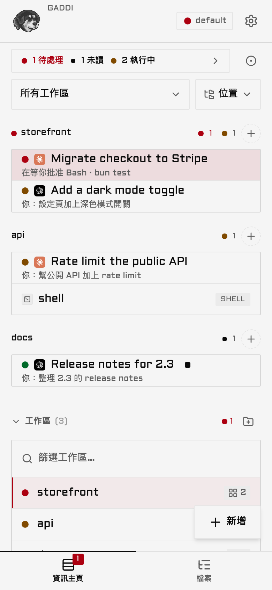
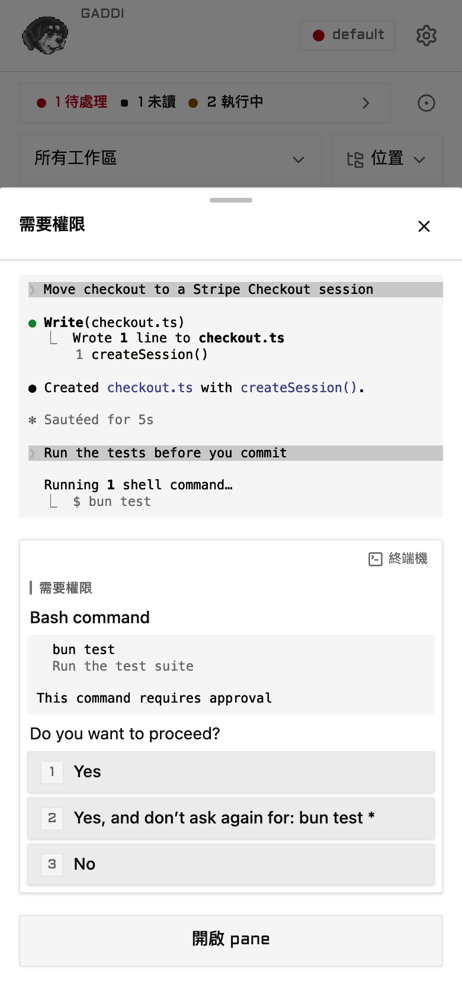
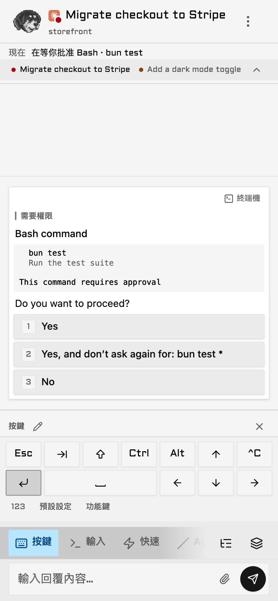
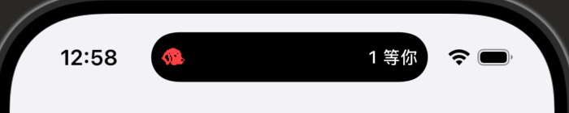
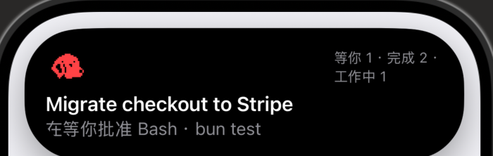
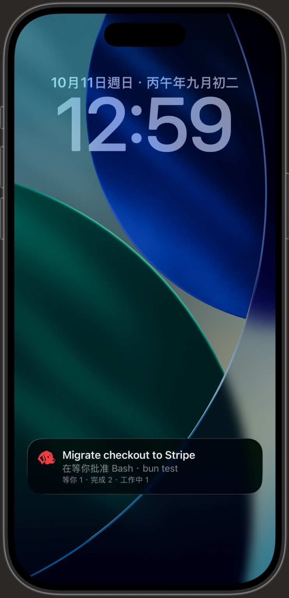

# Gaddi

<p align="center">
  
</p>

<p align="center"><a href="./README.md">English</a> · <b>繁體中文</b></p>

Gaddi 把你終端機裡的 AI coding agent 搬到手機上。Claude Code、Codex 這些照樣在電腦上的 Herdr、tmux
或 zellij 裡跑，手機只負責告訴你哪一隻在等你，你點一下就能回它，不用在手機上硬敲終端機。

它跑在你自己的電腦上，透過你的 Tailscale 網路連到手機。Gaddi 本身不用註冊帳號，沒有代管的伺服器，也不回傳使用資料；連線走的是你自己的 Tailscale。它不上架 App
Store：手機打開網址，加到主畫面就能用。

> **注意：** Gaddi 是 [GGGODLIN 的 fork](https://github.com/GGGODLIN/gaddi)，原專案是 Altan Sarisin 的
> [ColliePWA](https://github.com/AltanS/collie)，不是 ColliePWA 官方專案。它從原始碼安裝、自己發版。
> `collie` 指令和 Herdr 外掛沿用上游的名字，所以指令和文件裡看到的還是 Collie。

https://github.com/user-attachments/assets/b108cfdd-e0e9-48e2-a5f8-3146698adabb

<table>
  <tr>
    <td align="center" width="33%"><br><sub><b>需要你的排第一</b></sub></td>
    <td align="center" width="33%"><br><sub><b>在清單直接批准</b></sub></td>
    <td align="center" width="33%"><br><sub><b>手機鍵盤沒有的按鍵</b></sub></td>
  </tr>
</table>

影片和截圖裡的 agent 都是假資料。

## 能做什麼

- **需要你的 agent 排最上面。** 每個 pane 底下有一行字說它在幹嘛：在等你批准什麼，或你最後交代它的事。
- **不用點進 pane 就能批准。** 點一下卡住的那一列，權限詢問直接變成按鈕浮在總覽上。
- **agent 問你的東西都變成按鈕**：權限詢問、AskUserQuestion、plan 審核、選單。
- **手機鍵盤沒有的鍵**：Esc、Ctrl+C、Tab、方向鍵，還有你自己排的組合鍵。
- **在手機上開新工作**：開新的 agent、跑指令、開 worktree，哪台電腦都可以。
- **回頭看發生了什麼**：搜尋輸出、用 Chat 讀整段 session、看工作區的檔案和 diff，全部唯讀。
- **agent 停下來等你時推播通知**，要先開啟 Web Push（[Voice input and Web Push](./docs/voice-and-push.md)，英文）。

### iPhone 動態島

這個 fork 最大的加碼是一個 iPhone app，放在 [`ios/`](./ios/README.md)。它把 agent 的狀態放到動態島和鎖定畫面上，點一下就打開
Gaddi。可以自己 build，也可以側載每次發版附的 `.ipa`，兩種都是用你自己的 Apple ID 簽名。動態島由 app 自己向你的 Gaddi 讀狀態後更新，不經過推播服務。

<table>
  <tr>
    <td align="center" width="62%">
      <br>
      <sub><b>動態島</b>：有幾隻 agent 在等你</sub><br><br>
      <br>
      <sub><b>長按</b>：需要你的 pane、它在等什麼、各狀態的數量</sub>
    </td>
    <td align="center" width="38%">
      <br>
      <sub><b>鎖定畫面</b>：同一張卡片</sub>
    </td>
  </tr>
</table>

截圖裡的 agent 都是假資料。第二行「pane 在做什麼」預設不顯示，因為它可能一字不差地把你最新的 prompt 秀在動態島上；要開的話設
`ISLAND_SHOW_DETAIL = YES`。預設只顯示 pane 名稱和數量；pane 名稱仍會出現在鎖定畫面上，取名時要留意。

決定要不要裝之前，先看動態島要你付出什麼（細節在 [`ios/README.md`](./ios/README.md)，英文）：

- **iOS 18 以上的 iPhone，定位權限設成「永遠」**：app 靠這個在背景保持運作。背景耗電還沒量過。
- **每 8 小時要重新開一次**：iOS 最多讓即時動態顯示 8 小時，系統更新也可能提早結束它。
- **免費 Apple ID 每 7 天要重簽**：AltServer 連得到時，AltStore 會在背景自動處理；超過一週沒重簽，app 就打不開，要到 AltStore 手動重新整理。
- **要一台 Mac 或 Windows 來簽**：AltServer 沒有 Linux 版，主機是 Linux 的話，旁邊還是要有其中一台。

主畫面的網頁 app 和 iPhone app 是兩個不同的東西：

| | 主畫面網頁 app | iPhone app |
| --- | --- | --- |
| 批准、回覆、看 pane | 可以 | 可以，app 裡面就是同一個網頁 app |
| 動態島和鎖定畫面 | 沒有 | 有 |
| 推播通知 | 開啟 Web Push 後有 | 沒有，推播要留著網頁 app 收 |
| 配對 | 自己配對一次 | 要另外配對，跟網頁 app 分開 |
| 更新 | 跟著 Gaddi 本身更新 | 發版說明要求時，下載新的 `.ipa` 覆蓋安裝 |

## 安裝前先看

你需要：

- **一台 Mac 或 Linux，而且你離開時它要保持開機、連網**：Gaddi 和你的 agent 都跑在這台電腦上，手機只是讀它。Windows 還是實驗性質，見英文版的 [Windows](./README.md#windows)。
- **[Bun](https://bun.sh) 1.3.14 以上和 git。**
- **一個終端機多工器，而且 agent 要跑在它裡面。** [Herdr](https://herdr.dev) 是我每天在用的組合；tmux 和 zellij 也能用，但還是實驗性質（[Multiplexers](./docs/multiplexers.md)，英文）。在一般終端機分頁直接開的 agent 不會出現，要在多工器的 pane 裡開。
- **電腦和手機都裝 [Tailscale](https://tailscale.com)，在同一個 tailnet，並開啟 HTTPS**（管理後台 → DNS → Enable HTTPS）。Mac 上的 `tailscale` 指令要在 PATH 裡，Tailscale app 的設定裡可以安裝它。

我自己跑的是 Mac + Herdr + Claude Code + iPhone，這份 README 寫的就是這條路。其他組合有通過 CI，但還沒有人在這個 fork 上從頭到尾走過一次。

Gaddi 是給一個人用的：一個操作者、一個 tailnet，不要拿去共用或公開。

**Gaddi 本質上就是一個遠端 shell。** 一個 API 呼叫就能把任意按鍵送進正在跑的終端機。配對過的裝置可以讀到 pane 裡的所有輸出（原始碼、密鑰、環境變數、agent 的輸出），也能用你的使用者權限執行任何指令。它沒有沙箱，也沒有指令白名單，因為那樣就沒辦法用了。

每個請求都要來自用 `collie pair` 配對過的裝置，光知道網址不夠。配對一定是開著的。把配對過的手機當成能登入你帳號的 SSH 金鑰看待：Gaddi 只放在你的 tailnet 上、設定 `COLLIE_TRUSTED_USER` 讓只有你的 tailnet 帳號能進來（英文版的 [Variant A](./README.md#variant-a--tailscale-serve--person-identity-default)），也只配對你手上那支手機。完整的安全模型在 [`docs/security.md`](./docs/security.md)（英文）。

> 🚫 **絕對不要對它用 `tailscale funnel`**：`funnel` 會把 port 開到公開網路上，`serve` 才是只限你自己的 tailnet。不管什麼情況都不要 funnel Gaddi。

## 安裝

Gaddi 從原始碼安裝。先在多工器裡把 agent 開起來：`start` 會接上它找到正在跑的那一個，找不到就拒絕啟動。用 tmux 的話是：

```bash
tmux new -s agents      # 然後在裡面執行 claude（或 codex）
```

再開另一個終端機：

```bash
git clone --single-branch https://github.com/GGGODLIN/gaddi.git ~/.local/share/collie &&
  cd ~/.local/share/collie && bash scripts/collie-ctl.sh build && bin/collie start
```

每一步都要前一步成功才會跑。如果 `~/.local/share/collie` 已經存在（例如裝過上游版），clone 會在那裡停下，不會蓋掉它；先把它移走再裝。`--single-branch`
只抓 `main`，之後更新也只跟 `main`。`start` 會幫你跑 `tailscale serve`，並印出 HTTPS 網址。

接著放到手機上。下面的指令都在 `~/.local/share/collie` 裡執行；想用短指令 `collie`，可以先跑 `bin/collie link` 把它放進 PATH。

1. 執行 `bin/collie url`，用 iPhone 的 Safari 打開它印出的網址。
2. 點**分享**，選**加入主畫面**，然後從新的圖示打開 Gaddi。
3. 執行 `bin/collie pair`，在 Gaddi 的設定 → 系統 → 已配對裝置輸入那組 8 碼。

請在主畫面 app 裡手動輸入配對碼，不要掃 QR code：QR code 會用 Safari 打開，而在 Safari 完成的配對不一定會帶到主畫面 app。Android 用 Chrome，在 Gaddi 設定頁最上面的卡片點**安裝**。第一次啟動的其他細節在 [`docs/install.md`](./docs/install.md#start-it) 的 *Start it*（英文）。

`main` 只在發版或改文件時才會動，所以你裝到的程式碼一定是某個正式版本的程式碼。日常開發在 `dev`，那裡沒有替別人的環境測過。

## 更新與回滾

`collie update` 和 app 裡的更新提示都跟著[這個 fork 的 releases](https://github.com/GGGODLIN/gaddi/releases)
走。更新會拉 `main`、重新 build、重新啟動：

```bash
cd ~/.local/share/collie && bin/collie update
```

要退回舊版，checkout 那個版本的 tag，再 build 和重啟。請停在 2.x 以內：1.18.0 以前的版本，任何連得到網址的人不用配對就能讀所有 pane。

```bash
cd ~/.local/share/collie && git fetch --tags && git checkout v2.0.2 &&
  bash scripts/collie-ctl.sh build && bin/collie restart
```

這樣 checkout 會停在那個版本（detached）。要回到最新版，切回 `main` 再更新；只 checkout `main` 只會換原始碼，正在跑的 Gaddi 不會變。

```bash
cd ~/.local/share/collie && git checkout main && bin/collie update
```

> **注意：** 1.14.0 以前裝的版本拉不到新的 `main`。把 `~/.local/share/collie` 移走重裝就好；設定、配對和推播訂閱都存在
> `~/.config` 和 `~/.local/state`，不在那個資料夾裡。

## 選配工具

下表都是選配，沒裝的話 Gaddi 照常運作。前兩列會讀我自己寫的 Claude Code 工具的輸出，第三列是 iPhone app。

| 功能 | 需要 | 沒裝的話 |
| --- | --- | --- |
| pane 的一行描述改用 Claude 自己的 recap，畫面也會藏掉那個工具的按鈕列 | [cc-mod-waitwhat](https://github.com/GGGODLIN/cc-mod-waitwhat) | 描述改用正在等的批准，或你最新的 prompt |
| *Plain* 和 *Lost* 用白話重講一段 Claude session | [cc-sidecar-waitwhat](https://github.com/GGGODLIN/cc-sidecar-waitwhat)，寫在 `retell.toml` 裡（[Configure](./docs/configure.md#retell-a-claude-session)） | 不會出現這兩個選項 |
| agent 狀態顯示在 iPhone 動態島 | [`ios/`](./ios/README.md) 裡的 iPhone app，用你自己的 Apple ID build 或側載；Gaddi 和上游 Collie 都能接 | 沒有任何差別；Gaddi 設定裡填 app 位址的那一列只在 app 裡才看得到 |

pane 的那一行描述跟著 app 的語言顯示；recap 照 Claude 寫的原文顯示，推播內文仍是中文。

## 其他文件

文件、部署方式、Windows、架構和開發說明都在[英文版 README](./README.md#documentation) 和 [`docs/`](./docs/)，目前只有英文。

## 致謝

Gaddi 建立在 Altan Sarisin 的 [ColliePWA](https://github.com/AltanS/collie) 之上，採用
[MIT 授權](./LICENSE)。這個 fork 比上游多了什麼，從 `1.14.0` 起都記在 [`CHANGELOG.md`](./CHANGELOG.md)。少數只在我自己的環境才有意義的改動列在
[`FORK.md`](./FORK.md)，每一條都寫了它需要什麼；沒有那些工具時，它們不會干擾你。
